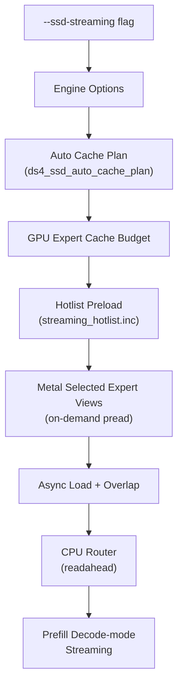

# SSD Streaming: DS4 → QW3 — Piano Operativo

## Contesto e Obiettivo

Portare il concetto di **SSD streaming** da DS4 a QW3, permettendo al modello Qwen3.6-35B-A3B di funzionare in modalità streaming dove i pesi degli esperti MoE vengono caricati on-demand da SSD invece di risiedere interamente in memoria GPU/RAM.

Questo è fondamentale per eseguire il modello su macchine con memoria limitata: solo un sottoinsieme degli esperti viene tenuto in cache GPU, e gli altri vengono letti dal file GGUF mappato via `mmap` quando il router li seleziona.

---

## Differenze Chiave tra i Modelli

| Caratteristica | DS4 (DeepSeek V4) | QW3 (Qwen3.6-35B-A3B) |
|---|---|---|
| **Esperti per layer** | 256 (Flash) / 384 (Pro) | 256 |
| **Esperti attivi (top-k)** | 6 | 8 |
| **Shared experts** | No (impliciti) | 1 esplicito |
| **Layers MoE** | 58-61 (layer routed) | **Tutti i 40** |
| **Expert FFN dim** | Variabile | 512 |
| **Quant tipica** | IQ2_XXS / Q2_K / Q4_K | IQ4_XS / IQ3_S / Q6_K |
| **Attenzione** | Standard con KV cache compressa | Ibrida: 30 DeltaNet + 10 GQA |
| **Expert byte per exp** | ~3-8 MB (dipende da quant) | ~1-3 MB (dim più piccola) |
| **Modello totale** | ~50-130 GB | ~20-35 GB |

> [!IMPORTANT]
> **QW3 ha MoE su tutti i 40 layer** (non solo un sottoinsieme come DS4), quindi il numero totale di esperti è `40 × 256 = 10.240`. Con top-8 routing e expert dim più piccola (512 vs DS4), ogni expert tensor è relativamente piccolo, ma il volume totale è comunque significativo.

---

## Architettura SSD Streaming in DS4

L'SSD streaming in DS4 si compone di diversi sottosistemi:



### Sottosistemi chiave:

1. **`ds4_ssd.c/h`** — Utility per parsing args, cache plan, memory lock simulation
2. **`ds4_engine_options`** — Flag `ssd_streaming`, `ssd_streaming_cold`, `ssd_streaming_cache_experts/bytes`, `ssd_streaming_preload_experts`
3. **`ds4_gpu_graph.ssd_streaming`** — Flag propagata al grafo GPU per condizionare i path di decode
4. **`ds4_streaming_hotlist.inc`** — Hotlist statica di esperti "hot" (pre-generata da profiling)
5. **Selected Expert Views** — Quando il router seleziona K esperti, si caricano solo le righe rilevanti del tensore di pesi (gate/up/down) in buffer GPU temporanei
6. **CPU Router** — Il router viene eseguito su CPU (dopo sync dei buffer) per avviare il pread degli esperti prima che la GPU li richieda
7. **Async Load + Overlap** — Pread degli esperti overlappato con il lavoro GPU dello shared expert
8. **Prefill Decode-mode** — Per il prefill lungo in streaming, ogni token viene processato in decode-mode one-at-a-time invece di batch

---

## Piano di Implementazione in 7 Fasi

---

### Fase 1: Infrastruttura SSD Base

#### [NEW] [qw3_ssd.h](file:///Users/pasqualecapasso/Downloads/ds4-main/qw3/qw3_ssd.h)

Adattamento diretto di [ds4_ssd.h](file:///Users/pasqualecapasso/Downloads/ds4-main/ds4/ds4_ssd.h):
- `qw3_ssd_cache_plan` struct con `model_target_bytes`, `cache_bytes`, `effective_cache_bytes`, `cache_experts`
- `qw3_parse_gib_arg()` — Parsing `NNgb` da CLI
- `qw3_parse_streaming_cache_experts_arg()` — Parsing numero esperti o byte budget
- `qw3_ssd_cache_experts_for_byte_budget()` — Conversione byte → numero esperti
- `qw3_ssd_auto_cache_plan()` — Auto-calcolo del budget di cache dato `recommended_bytes` del sistema
- `qw3_ssd_memory_lock_acquire/release()` — Per `--simulate-used-memory`

#### [NEW] [qw3_ssd.c](file:///Users/pasqualecapasso/Downloads/ds4-main/qw3/qw3_ssd.c)

Implementazione con le costanti QW3:
- `per_expert_bytes` deve essere calcolato dalla dimensione effettiva dei tensori `ffn_gate_exps`, `ffn_up_exps`, `ffn_down_exps` nel file GGUF
- `non_routed_bytes` include embedding, norms, attention weights, shared expert weights, router weights — tutto ciò che **non** è esperto routed
- `max_model_experts = QW3_N_LAYER × QW3_N_EXPERT = 40 × 256 = 10.240`

> [!NOTE]
> A differenza di DS4 dove `per_expert_bytes` è uniforme per quant type, in QW3 potrebbe variare se i layer hanno quant diverse. Per ora si assume un valore uniforme calcolato dal primo layer.

---

### Fase 2: Engine Options e CLI

#### [MODIFY] [qw3.h](file:///Users/pasqualecapasso/Downloads/ds4-main/qw3/qw3.h)

Aggiungere a `qw3_engine_options`:
```c
#include "qw3_ssd.h"

typedef struct {
    const char *model_path;
    qw3_backend backend;
    int n_threads;
    bool warm_weights;
    /* SSD streaming */
    uint32_t ssd_streaming_cache_experts;
    uint64_t ssd_streaming_cache_bytes;
    uint32_t ssd_streaming_preload_experts;
    uint64_t simulate_used_memory_bytes;
    bool ssd_streaming;
    bool ssd_streaming_cold;
} qw3_engine_options;
```

#### [MODIFY] [qw3.c](file:///Users/pasqualecapasso/Downloads/ds4-main/qw3/qw3.c)

- In `struct qw3_engine`: aggiungere campi `ssd_streaming`, `ssd_streaming_cold`, `ssd_streaming_cache_experts`, `ssd_streaming_preload_experts`, `simulated_memory`
- In `qw3_engine_open()`: propagare le opzioni, calcolare `per_expert_bytes` dal GGUF, stampare il piano di cache

#### [MODIFY] [qw3_cli.c](file:///Users/pasqualecapasso/Downloads/ds4-main/qw3/qw3_cli.c)

Aggiungere parsing dei flag CLI:
- `--ssd-streaming` → `opt.ssd_streaming = true`
- `--ssd-streaming-cold` → `opt.ssd_streaming_cold = true`
- `--streaming-cache N` / `--streaming-cache NNgb` → `opt.ssd_streaming_cache_experts` o `opt.ssd_streaming_cache_bytes`
- `--streaming-preload N` → `opt.ssd_streaming_preload_experts`
- `--simulate-used-memory NNgb` → `opt.simulate_used_memory_bytes`

#### [MODIFY] [qw3_bench.c](file:///Users/pasqualecapasso/Downloads/ds4-main/qw3/qw3_bench.c)

Analogamente, aggiungere le stesse opzioni.

#### [MODIFY] [qw3_agent.c](file:///Users/pasqualecapasso/Downloads/ds4-main/qw3/qw3_agent.c)

Analogamente, aggiungere le stesse opzioni.

#### [MODIFY] [Makefile](file:///Users/pasqualecapasso/Downloads/ds4-main/qw3/Makefile)

Aggiungere `qw3_ssd.o` come dipendenza dei target.

---

### Fase 3: Hotlist e Preload Esperti

#### [NEW] [qw3_streaming_hotlist.inc](file:///Users/pasqualecapasso/Downloads/ds4-main/qw3/qw3_streaming_hotlist.inc)

Tabella statica `qw3_default_streaming_hotlist[][2]` con le coppie `{layer, expert}` ordinate per frequenza d'uso.

> [!IMPORTANT]
> Questo file deve essere **generato da profiling** sul modello Qwen3.6-35B-A3B con un dataset rappresentativo. Per iniziare si può partire con una hotlist vuota e aggiungerne una reale successivamente. DS4 usa un formato `{uint16_t layer, uint16_t expert}` che è adatto anche per QW3.

#### [MODIFY] [qw3.c](file:///Users/pasqualecapasso/Downloads/ds4-main/qw3/qw3.c)

Aggiungere:
- `#include "qw3_streaming_hotlist.inc"` (dopo le definizioni degli esperti)
- `metal_graph_streaming_expert_hotlist_enabled()` — Controlla se l'hotlist è attivo
- `metal_graph_streaming_expert_hotlist_add()` — Aggiunge un expert all'hotlist del cache
- `metal_graph_streaming_expert_hotlist_load_default()` — Carica la hotlist statica
- `metal_graph_streaming_expert_hotlist_load_file()` — Carica hotlist da file esterno (opzionale)
- `metal_graph_streaming_expert_preload_count()` — Quanti esperti pre-caricare

Queste funzioni sono una traduzione diretta delle corrispondenti in DS4 ([ds4.c:13369-13553](file:///Users/pasqualecapasso/Downloads/ds4-main/ds4/ds4.c#L13369-L13553)).

**Adattamenti QW3:**
- `QW3_N_LAYER = 40` (non 61), `QW3_N_EXPERT = 256` (non 384)
- Il cap automatico di preload va ricalibrato: con 40×256=10.240 esperti totali ma expert più piccoli, un cap di 2048-4096 è ragionevole
- La hotlist file usa lo stesso formato testuale: `layer expert hits`

---

### Fase 4: Selected Expert Views nel Metal Backend

Questo è il cuore del meccanismo: invece di caricare tutti i 256 esperti per layer nella GPU, il sistema carica solo quelli selezionati dal router.

#### [MODIFY] [qw3_metal.h](file:///Users/pasqualecapasso/Downloads/ds4-main/qw3/qw3_metal.h)

Aggiungere le API per il cache streaming:
```c
void qw3_metal_set_ssd_streaming(int enabled);
void qw3_metal_set_streaming_expert_cache_budget(uint32_t experts);
int qw3_metal_stream_expert_cache_reset_route_hotness(void);
int qw3_metal_stream_expert_ensure_loaded(
    uint64_t gate_offset, uint64_t up_offset, uint64_t down_offset,
    uint32_t gate_type, uint32_t up_type, uint32_t down_type,
    uint32_t expert, uint32_t n_in, uint32_t n_ff,
    uint32_t layer, uint32_t priority);
```

#### [MODIFY] [qw3_metal.m](file:///Users/pasqualecapasso/Downloads/ds4-main/qw3/qw3_metal.m)

Implementare il cache manager degli esperti:
- **Expert cache slots**: pool di buffer Metal shared pre-allocati in base al budget
- **LRU eviction**: quando un expert non è nel cache e il pool è pieno, si evince il meno usato di recente
- **pread loading**: leggere gli esperti dal file GGUF mappato nei buffer cache
- **Slot lookup**: tabella hash `(layer, expert) → slot_index`

> [!WARNING]
> La complessità principale è nel Metal layer di QW3. Attualmente i kernel MoE (es. `qw3_metal_session_sparse_moe_topk`) accedono ai tensori degli esperti tramite offset nel modello GGUF mappato. Con lo streaming, dovranno accedere ai buffer cache invece che al mapping diretto. Questo richiede un'interfaccia per risolvere `(tensor_offset, expert_id) → cache_buffer_ptr`.

#### Strategia per QW3

A differenza di DS4 che ha `ds4_gpu_tensor` come astrazione, QW3 usa direttamente `tensor_offset` nella mmap del modello. Il percorso proposto:

1. Quando `ssd_streaming = false` (default): i kernel funzionano come oggi, accedendo ai tensori tramite offset nel modello mappato
2. Quando `ssd_streaming = true`: prima dell'invocazione del kernel MoE, si chiama `qw3_metal_stream_expert_ensure_loaded()` per ogni expert selezionato, che copia i dati dal file nel cache slot. I kernel MoE ricevono il puntatore al cache slot

---

### Fase 5: CPU Router per Streaming

In modalità streaming, è vantaggioso eseguire il router sulla CPU: dopo aver letto l'output dell'attention (ffn_norm), si calcola la routing decision sulla CPU e si avvia il pread degli esperti **prima** che la GPU abbia bisogno dei loro pesi.

#### [MODIFY] [qw3.c](file:///Users/pasqualecapasso/Downloads/ds4-main/qw3/qw3.c)

Aggiungere `metal_graph_decode_cpu_router()`:
1. `qw3_metal_end_commands()` — Sync GPU
2. Leggere `ffn_norm` output dal buffer GPU alla CPU
3. Calcolare `matvec` router: `logits = ffn_norm × gate_inp`
4. `softmax` → `topk(8)` → calcolare pesi
5. Scrivere `router_selected` e `router_weights` nel buffer GPU
6. Avviare pread degli esperti selezionati
7. `qw3_metal_begin_commands()` — Riprendere encoding GPU

**Adattamenti QW3:**
- Router usa sigmoid/softplus softmax (verifica la formula esatta del routing nel modello Qwen)
- QW3 usa `top-8` (non top-6) quindi si selezionano 8 esperti

#### [MODIFY] [qw3.c](file:///Users/pasqualecapasso/Downloads/ds4-main/qw3/qw3.c) — Decode Path

Nel path di decode di un singolo token:
```
Per ogni layer:
  1. Attention (DeltaNet o GQA)
  2. FFN norm
  3. [Se streaming] CPU Router + Expert Pread
  4. Shared Expert (overlapped con pread)
  5. Routed Experts (dal cache)
  6. Combine + Residual
```

---

### Fase 6: Async Load e Overlap

#### [MODIFY] [qw3_metal.m](file:///Users/pasqualecapasso/Downloads/ds4-main/qw3/qw3_metal.m)

- **Overlap shared/routed**: il kernel shared expert viene eseguito sulla GPU mentre gli esperti routed vengono caricati dal disco in parallelo
- **Early commit**: dopo aver encodato i comandi per lo shared expert, si fa commit e si avvia il caricamento degli esperti routed; quando il caricamento è completo, si encodano i comandi per gli esperti routed

#### [MODIFY] [qw3.c](file:///Users/pasqualecapasso/Downloads/ds4-main/qw3/qw3.c) — Readahead

- **Layer N readahead**: durante il processing del layer N, se possibile si calcola la routing del layer N+1 in anticipo e si inizia il preload
- Questo richiede un pipeline più sofisticato e può essere implementato come ottimizzazione successiva

---

### Fase 7: Prefill Decode-mode Streaming

Per prompt lunghi in modalità streaming, il prefill batch non funziona (richiederebbe tutti gli esperti di ogni layer in memoria). Si usa un approccio decode-mode:

#### [MODIFY] [qw3.c](file:///Users/pasqualecapasso/Downloads/ds4-main/qw3/qw3.c)

- `metal_graph_use_streaming_decode_prefill()` — Determina se usare decode-mode per il prefill
- `metal_graph_prefill_decode_streaming_range()` — Processa i token del prefill uno alla volta usando il path di decode con streaming
- Questo è molto più lento del prefill batch, ma è l'unico modo per funzionare con memoria limitata

> [!NOTE]
> In QW3 il prefill batch è particolarmente importante per le performance a causa del DeltaNet recurrent state. Processare un token alla volta nel prefill è significativamente più lento. Un'ottimizzazione possibile è processare mini-batch di token dove l'unione degli esperti selezionati dal batch sta nel cache.

---

## Ordine di Implementazione Raccomandato

```mermaid
gantt
    title Piano di Implementazione SSD Streaming QW3
    dateFormat  X
    axisFormat %s

    section Fondamenta
    Fase 1 - qw3_ssd.c/h           :a1, 0, 2
    Fase 2 - Engine opts + CLI      :a2, 2, 3

    section Core Streaming
    Fase 4 - Metal Expert Cache     :a4, 3, 6
    Fase 3 - Hotlist + Preload      :a3, 5, 3

    section Ottimizzazioni
    Fase 5 - CPU Router             :a5, 6, 3
    Fase 6 - Async Load             :a6, 8, 3
    Fase 7 - Prefill Streaming      :a7, 9, 3
```



> [!TIP]
> La Fase 4 (Metal Expert Cache) è la più complessa e critica. Suggerisco di iniziare con un'implementazione semplice sincrona (load blocking) e poi aggiungere l'async come ottimizzazione nella Fase 6.

---

## Open Questions

> [!IMPORTANT]
> **Q1: Profiling hotlist** — Hai già accesso al modello Qwen3.6-35B-A3B per generare una hotlist di esperti da profiling? Senza hotlist, la prima esecuzione (cold start) sarà significativamente più lenta.

> [!IMPORTANT]
> **Q2: Target hardware** — Su quale hardware prevedi di eseguire? Il budget di memoria GPU è fondamentale per calcolare il cache plan. Ad esempio:
> - Mac con 32GB unified memory → ~20GB per il cache
> - Mac con 64GB → ~45GB per il cache
> - Mac con 16GB → modalità streaming quasi completa

> [!IMPORTANT]
> **Q3: Quant type del modello** — Quale quantizzazione usa il tuo GGUF? (IQ4_XS, Q4_K, IQ3_S, Q6_K?) Questo influenza la dimensione per-expert e quindi il budget di cache.

> [!WARNING]
> **Q4: Priorità overlap vs semplicità** — Vuoi implementare subito l'overlap async (Fasi 5-6) o preferisci prima un'implementazione funzionante ma più lenta (Fasi 1-4 con load sincrono)?

---

## Verification Plan

### Automated Tests
- Unit test per `qw3_ssd.c`: parsing args, cache plan computation
- Smoke test: eseguire `./qw3 --ssd-streaming -m model.gguf -p "Hello"` e verificare output corretto
- Regression test: confrontare output greedy con e senza streaming (devono essere identici)

### Manual Verification
- Misurare l'occupazione di memoria con `Activity Monitor` con e senza streaming
- Benchmark `qw3-bench` con diversi budget di cache (N esperti) e confrontare tok/s
- Verificare che il cold start con hotlist sia significativamente più rapido del cold start senza

### Performance Baselines
```bash
# Senza streaming (baseline)
./qw3 -m model.gguf -p "Explain quantum computing" -n 100 --metal

# Con streaming, cache generoso
./qw3 -m model.gguf --ssd-streaming --streaming-cache 4096 -p "Explain quantum computing" -n 100 --metal

# Con streaming, cache minimo
./qw3 -m model.gguf --ssd-streaming --streaming-cache 512 -p "Explain quantum computing" -n 100 --metal
```
